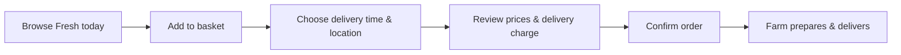
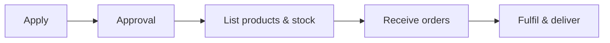

<!-- Replace with your logo: docs/screenshots/logo.png -->

# Saplaya

**Farm-fresh produce and pantry essentials, one marketplace.**

Connecting customers with farmers, for your home or your business.

[Visit the website](https://www.saplaya.org) · [How it works](https://www.saplaya.org/how-it-works) · [Help & FAQ](https://www.saplaya.org/faq)

---

## Screenshots

| Home | Fresh today | Product details |
|:---:|:---:|:---:|
|  |  |  |

| Basket | Checkout & delivery | Farmer panel |
|:---:|:---:|:---:|
|  |  |  |

> Add your images to `docs/screenshots/` using the file names above. Phone screenshots look best at 1080 × 1920 px (portrait).

---

## Get the app

| Platform | Status |
|---|---|
|  Web | Live at [www.saplaya.org](https://www.saplaya.org) |
|  Android (Google Play) | Coming soon, link will be added at launch |
|  iOS (App Store) | Coming soon |

<!-- When live, replace the Google Play badge above with:

-->

---

## What you can do with Saplaya

-  **Browse fresh stock**: see what is available today from farms near you.
-  **Retail or wholesale**: shop for your home or your business, with volume pricing on eligible products.
-  **Choose a delivery time**: pick a slot that suits you and see delivery charges before you confirm.
-  **Clear checkout**: final prices and any delivery charge are shown before you place an order, and available payment methods appear at checkout.
-  **Nearby farms first**: optional location access helps prioritize farms close to you.

## Shopping with Saplaya

1. Browse [Fresh today](https://www.saplaya.org/fresh-today), search for products, and choose retail or wholesale.
2. Select products and quantities for your basket. Wholesale minimums and volume prices depend on the product and quantity.
3. Choose a delivery time and provide your contact details. A precise delivery location is required to calculate availability and delivery charges.
4. Review the final prices and any delivery charge before confirming. Available payment methods are shown at checkout.

Location access is optional when browsing and helps prioritize nearby farms. Checkout totals are shown in Tanzanian shillings (TZS); other display currencies are approximate.

## For farmers

Farmers can [apply to join Saplaya](https://www.saplaya.org/for-farmers). Approved farms can manage their listings, stock, and orders through their farm panel. Team access is restricted to the responsibilities assigned to each member.

---

## Learn more

- [How it works](https://www.saplaya.org/how-it-works)
- [Questions and help](https://www.saplaya.org/faq)
- [Privacy policy](https://www.saplaya.org/privacy)

 Made for farmers and the people who eat their food.

© Saplaya · [www.saplaya.org](https://www.saplaya.org)

